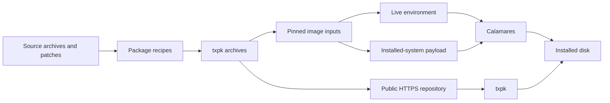

# How Tuxenix fits together

[← Tuxenix](../README.md) · [Engineering notes](engineering.md)

Tuxenix assembles a distribution from LFS/BLFS-oriented recipes. Its own
packaging and image tooling connect those builds to an installable system.
This page describes the published October 22 baseline; later candidates are
identified in the [status record](status.md).

## From source to installed system

A recipe has `package.yml` metadata, a `build.sh` and its source inputs.
Builds stage their output in `TXPK_PACKAGE_BUILD_DIST_DIR`. The resulting
`.txpk.tar.bz2` archive carries metadata and a payload beneath `files/`.
Package descriptions belong in metadata so tools can read them.

The public repository retains versioned archives and indexes. `txpk` resolves
packages from `https://tuxenix.org/1-lts/`. The live environment and installed
system are separate roots: an installer dependency need not become part of
the installed desktop.

The October 22 image's [288 pinned archive inputs](releases/2026-10-22-packages.json)
record each package's version, path, SHA-256 and destination roots. This is
more precise than rebuilding from whatever happens to be newest in a cache.
The manifest is an input inventory; it does not by itself establish that a
rebuild will be byte-for-byte identical.

## Startup and services

`dinit` is PID 1. `tuxenix-dinit-services` supplies the boot graph under
`/etc/dinit.d`, including filesystem preparation, device setup, networking,
console login, SSH, audio-state restoration and firewall startup.

The dependency ordering matters. Device discovery needs mounted runtime
filesystems. NetworkManager needs D-Bus and its Wi-Fi supplicant. The SSH
launcher prepares its account, runtime directories and host keys before
starting `sshd`. These are responsibilities of the installed system, not
steps a user should have to repeat after each boot.

| Package | Responsibility |
| --- | --- |
| `dinit` | Init, service supervision and the shutdown backend |
| `tuxenix-dinit-services` | Tuxenix service definitions and boot ordering |
| `systemd-compat` | udev, tmpfiles and libraries needed by other components |
| `power-utils` | Conventional `shutdown` and `reboot` commands; separate October 29 update |

`systemd-compat` does not supply systemd as PID 1, `systemctl`, journald or
logind. Keeping the compatibility libraries allows applications to use device
discovery without changing the init system.

## Desktop and graphics

Installed systems reach a text login. `startx` launches the IceWM session
from a normal user account. XLibre supplies the display server, with a
matching libinput module. The package name `xorg-server` and executable
names `Xorg` and `X` are retained for compatibility with existing consumers.

The October 22 manifest pins XLibre server package 25.1.9 and input driver
25.0.1. The patched server package 25.1.9.1 belongs to the pending source
integration. Server and driver compatibility must be checked together.

Native libraries live under `/usr/lib`; the i686 runtime lives under
`/usr/lib32`. This supports software that needs both architectures without
replacing the native system libraries. Graphics checks exercise both native
and 32-bit OpenGL/Vulkan paths. Software rendering can establish that the
desktop starts, but cannot establish physical GPU acceleration.

NetworkManager handles network profiles. ALSA tools and dinit state
restoration handle audio. Desktop utilities provide sound setup, timezone
selection and battery reporting. Their short command names are documented
in [getting started](getting-started.md).

## Installation and updates

Calamares runs in the live environment and installs a separate system
payload. Tuxenix's configuration and modules handle partition planning,
network-profile transfer, account setup and EFI installation.

The supported installation path is UEFI, GPT and ext4. On a shared EFI
System Partition, the installer preserves other loaders and checks available
space before writing Tuxenix files. Changes to disk layout stay queued until
the user confirms Install.

The image and package repository have independent release dates. Installing
`power-utils` updates an installed machine; it does not change a downloaded
October 22 ISO. A source merge similarly does not publish a package or qualify
a new image.

## Source map

| Location | Role |
| --- | --- |
| [This repository](../README.md) | Public documentation, release evidence summaries and issue reports |
| [Package sources: `tuxenix-steam-multilib`](https://gitlab.anysolo.com/opensource/anysolo-linux/pkg-sources/-/tree/tuxenix-steam-multilib) | Recipes, source patches, dinit services and desktop packages |
| [Installer: `tuxenix-steam-publication`](https://gitlab.anysolo.com/opensource/anysolo-linux/installer/-/tree/tuxenix-steam-publication) | Toolkit, image construction, installer configuration and release records |
| [Package catalog](https://tuxenix.org/packages.html) | Published binary packages |
| [Release timeline](https://tuxenix.org/releases.html) | Published image and package changes |

GitLab access may require sign-in. The separate GitHub toolkit repository is
private and is not a public source download. Cloning this overview repository
does not give you the full distribution build tree.

For source changes, use the active branches above and record exact revisions
with test results. Their pending merge requests are listed in
[release status](status.md#pending-source-integration). Third-party components
retain their own licenses; this overview does not apply a blanket license to
the distribution.
