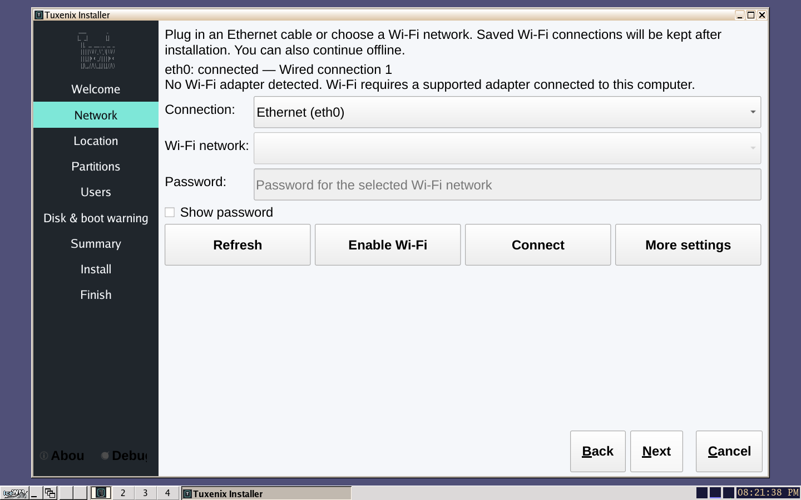

# Install and use Tuxenix

[← Tuxenix](../README.md) · [Release status](status.md)

These notes describe the **October 22, 2026** image. The
[full installation guide](https://tuxenix.org/install.html) covers manual
partitioning and updates to existing installations.

## Prepare

Use an x86_64 machine or VM with UEFI firmware and Secure Boot disabled.
The installation target must use GPT, with an ext4 root partition and a
FAT32 EFI System Partition. Plan at least 20 GiB for root. Encrypted, LVM
and RAID installation targets are outside the supported workflow.

For a first trial, use a disposable virtual disk. The final-image installation
test used a fresh 64 GiB QEMU disk. That is a test configuration, not a minimum
disk requirement. Earlier 2 GiB RAM live-boot checks belong to the October 17
image; they do not establish a minimum for every installation or workload.

Download both files into the same directory:

```sh
curl -fLO https://tuxenix.org/iso/tuxenix-dinit-desktop-2026-10-22.iso
curl -fLO https://tuxenix.org/iso/tuxenix-dinit-desktop-2026-10-22.iso.sha256
sha256sum -c tuxenix-dinit-desktop-2026-10-22.iso.sha256
```

The result should end in `OK`. The image is **1,313,968,128 bytes** with SHA-256:

```text
8ae76d8d70ffc346c675ba66cbea269b6d2bb9f470c9f94b43e0a5cd9286fc9e
```

Attach the ISO as the VM's boot media, or write it to a USB drive using an
image writer. Check the USB's model and capacity before writing: that
operation erases the selected device. Choose its **UEFI** entry when booting.

## Work through the installer

Open the installer from the live desktop. On the Network page, use Ethernet
or select a detected Wi-Fi adapter and network. You can continue offline.
Saved connections are copied to the installed system.



*October 22 image in QEMU. The guest has Ethernet; this screenshot does not
show a physical Wi-Fi connection. [Screenshot record](../assets/README.md).*

Choose your timezone and create your account. For a blank drive,
**Use entire selected drive** proposes a 512 MiB FAT32 EFI partition and an
ext4 root using the remaining space. Review the disk model, size and proposed
changes before selecting Install.

For a disk with data to keep, use
[manual partitioning](https://tuxenix.org/install.html#manual-title).
Create or select an ext4 root at `/`. Reuse an existing EFI System Partition
at `/boot/efi` without formatting it. Do not create a new partition table on
a disk whose existing partitions you want to preserve.

The installer queues partition edits until Install. In the final October 22
test, no target-disk writes occurred through the Summary page. Shared-ESP
preservation was tested on the October 17 base; Windows and BitLocker have
not been qualified. Keep a backup of data you cannot replace.

## First boot

After installation, remove the live media and boot from the installed disk.
Log in with the normal account you created. To start IceWM:

```sh
startx
```

Use a terminal inside the desktop for everyday tools:

| Task | Command | Run as |
| --- | --- | --- |
| Configure networking | `nmtui` | Normal user; authenticate if prompted |
| Install a package | `sudo txpk --install htop` | Normal user with sudo |
| Set up sound | `sound-setup` | Normal user |
| Read the battery state | `battery-status` | Normal user |
| Choose a timezone | `sudo timezone-config --select` | Normal user with sudo |

Sound Setup lets you select a playback device and test it before saving the
mixer state. A successful device listing alone does not prove audible sound.
Browse available software in the [package catalog](https://tuxenix.org/packages.html).

## Shut down or reboot

The October 29 command update is a separate download; it is not included in
the October 22 ISO. Install it on the installed system:

```sh
sudo txpk --install power-utils
```

After saving your work, use **one** of these commands:

| Action | Command |
| --- | --- |
| Power off immediately | `sudo shutdown` |
| Restart | `sudo reboot` |

These wrappers use `dinit-shutdown` options. Scheduled forms such as
`shutdown now` are not supported. Before installing the wrapper package,
`sudo dinit-shutdown -p` powers off and `sudo dinit-shutdown -r` reboots.

## Graphics and optional software

The image includes native and 32-bit graphics runtime libraries. Hardware
acceleration still depends on the GPU, kernel driver and firmware. Follow
the [graphics setup guide](https://tuxenix.org/install.html#gaming-title)
for detection, package updates and the separate kernel-activation step.

Steam is an optional download. Existing working installations can stay in
place. A client reaching its sign-in screen is not evidence that games or
Proton work on a particular GPU; see the [test record](status.md).

If a step fails, retain its full output before retrying. Report the ISO date,
whether you are in the live or installed system, and the last successful
step in a [bug report](https://github.com/elgun-dev/Tuxenix/issues/new?template=bug-report.yml).
